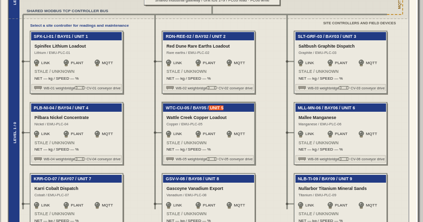
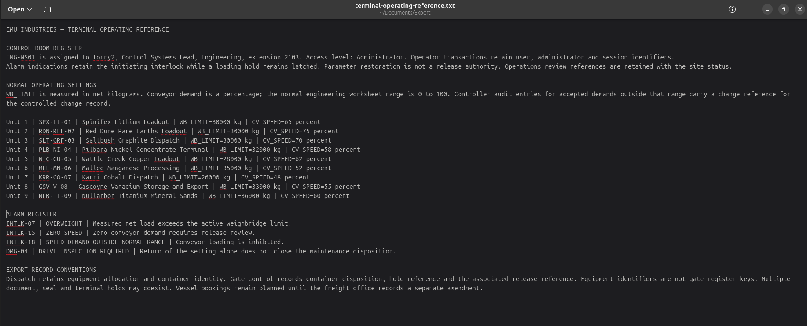
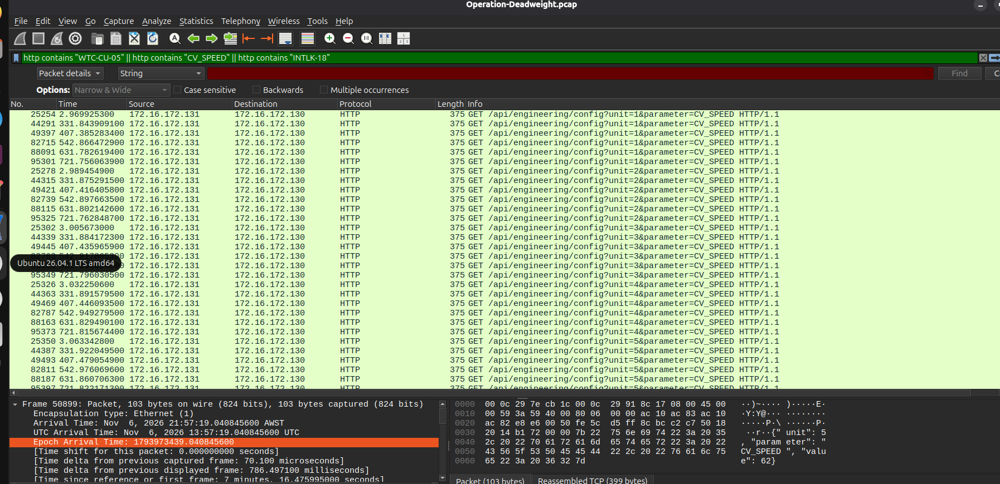
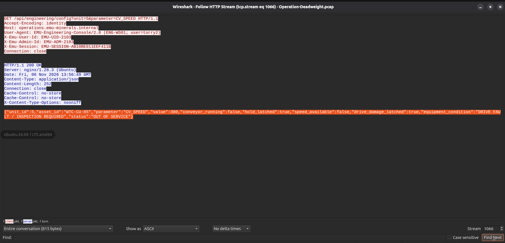
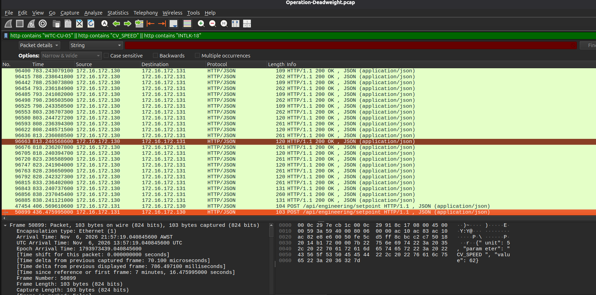
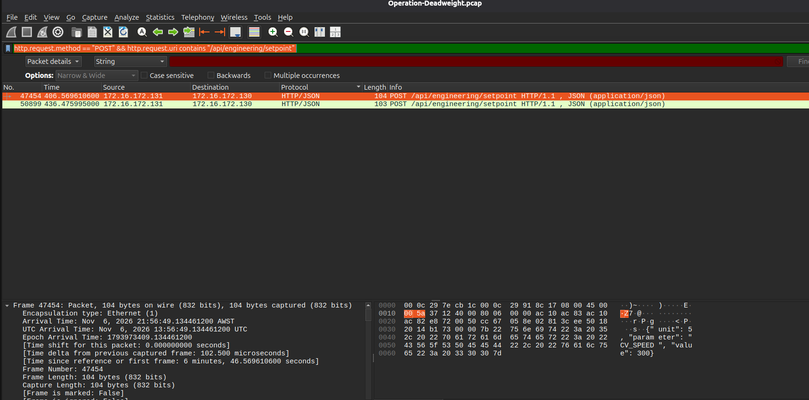
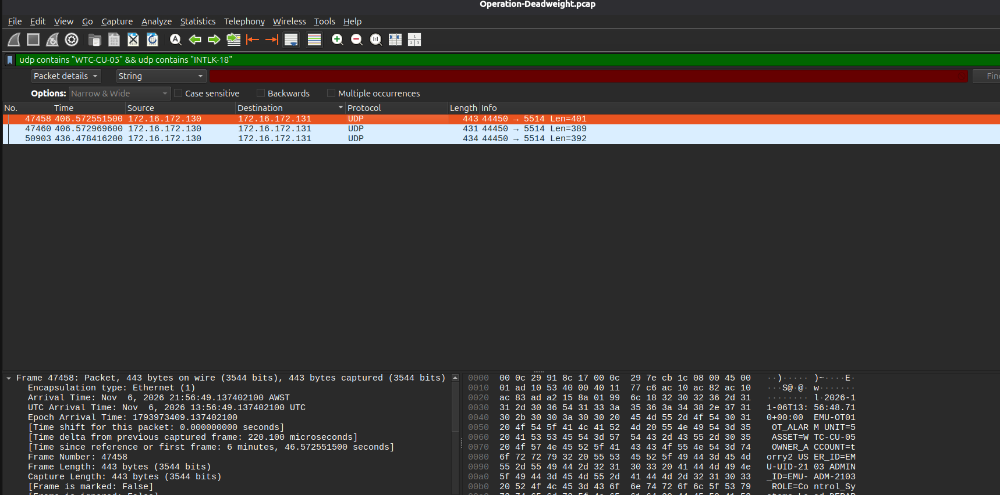
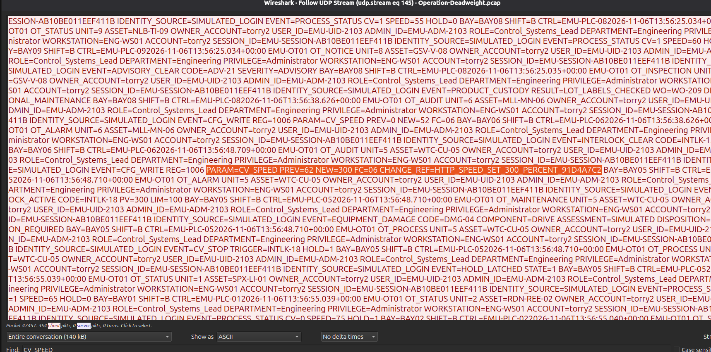

# I am speed Solution

**Difficulty:** Medium

## Question

One of EMU Industries’ conveyors decided to full-on “send it”! Sabotage, an insider threat, or just lazy EMUs? Can you pin down the change reference ID for the anomalous configuration changes behind the incident at Wattle Creek Copper Loadout?

**Submit:** EMU{CHANGE_REF}

## **Overview**

This challenge asks you to find the change reference ID behind the conveyor incident at EMU Industries’ Wattle Creek Copper Loadout site.

The `torry2` account was used to change the conveyor speed from 62% to 300%, well beyond the normal operating range of 0–100%. The change bypassed the Engineering Console's frontend limits and was accepted by the backend, causing damage to the conveyor drive.

The challenge asks you to identify the `CHANGE_REF` associated with this configuration change.

## Solution

By now, you should have access to the network topology from Challenge 2. The question asks you to find the change reference ID for Wattle Creek Copper Loadout. Looking at the network topology, you can see that the site is referenced as `WTC-CU-05 / BAY05`. You can use `WTC-CU-05` to narrow down the search in Wireshark.




Going back to Challenge 3, you should already be familiar with the alarm and alert codes found in the `terminal-operating-reference.txt` file.



For this challenge, the alert code we're specifically looking for is `INTLK-18`, which means `SPEED DEMAND OUTSIDE NORMAL RANGE`.

This is important because the challenge mentions a conveyor speeding out of control, and the alarm register gives us the exact code needed to narrow down the search.

The document also confirms that the normal operational speed range is 0 to 100, consistent with the Engineering Console's limits.

```
INTLK-18 | SPEED DEMAND OUTSIDE NORMAL RANGE | Conveyor loading is inhibited.
```

Looking at how an engineer can control the conveyor speed also gives us a clue about which parameters to filter on. Specifically, the conveyor speed parameter `CV_SPEED` can be found in the Engineering Console 


You'll also notice that the maximum conveyor speed you can set is 100%, which matches the operating range stated in the document. So, the idea is to look for anything above 100%, as that would be suspicious. Hopefully, this comes across in the question when it says, “EMU Industries’ conveyors decided to full-on ‘send it’!”

So, we now have Six parameters we can filter on.

| Field or code | Meaning |
| --- | --- |
| `WTC-CU-05` | Wattle Creek Copper's equipment ID. |
| `BAY05` | The loadout bay associated with the equipment. |
| `UNIT=5` | The controller unit number for Wattle Creek Copper. |
| `CV_SPEED` | The conveyor speed setting  |
| `INTLK-18` | The interlock code for a speed demand outside the normal range. |
| `SPEED DEMAND OUTSIDE NORMAL RANGE`. | Message Parameter |

Filtering for `WTC-CU-05`, `CV_SPEED`, and `INTLK-18` gives us a lot of information about what's happening at the site.

```
display filter: http contains "WTC-CU-05" || http contains "CV_SPEED" || http contains "INTLK-18"
```



You'll notice a lot of GET requests checking the conveyor speeds across different units. Since we're interested in Wattle Creek Copper Loadout (Unit 5), we want to focus on:

```
GET /api/engineering/config?unit=5&parameter=CV_SPEED HTTP/1.1
```



Looking at the response, we can see a bunch of messages saying the conveyor is out of service and needs inspection. What's strange is that the conveyor speed is showing 300%, well above the normal operating limit of 100%.

```
{
  "unit_id": 5,
  "asset_id": "WTC-CU-05",
  "parameter": "CV_SPEED",
  "value": 300,
  "conveyor_running": false,
  "hold_latched": true,
  "speed_available": false,
  "drive_damage_latched": true,
  "equipment_condition": "DRIVE FAULT / INSPECTION REQUIRED",
  "status": "OUT OF SERVICE"
}
```

But this only tells us the conveyor's current status. It doesn't confirm how the speed was changed or who made the change. Since GET requests only retrieve information, maybe we should look for POST requests that might show someone changing the conveyor speed.

We can see two already.



Specifically, we're interested in:

```
POST /api/engineering/setpoint HTTP/1.1
```

This endpoint is used to submit engineering configuration changes, so it might help us track down what caused the incident.

```
display filter: http.request.method == "POST" && http.request.uri contains "/api/engineering/setpoint"
```



Looking at the POST request, we can see that the conveyor speed for Unit 5 was changed from 62% to 300%, well above the normal operating limit of 100%.

```
{"unit": 5, "parameter": "CV_SPEED", "value": 62}

to 

{"unit": 5, "parameter": "CV_SPEED", "value": 300}
```

This confirms that someone submitted a configuration change through the engineering API, bypassing the normal speed limit enforced by the Engineering Console's frontend. Looking at the HTTP logs might not give us the change reference ID, so let's pivot to the UDP audit logs instead.

We can narrow down the search using the site ID and alert code.

```
 display filter: udp contains "WTC-CU-05" && udp contains "INTLK-18"
```



Following the UDP stream gives us a lot of information, but luckily, we already have a few parameters to work with. Since we know `CV_SPEED` was changed to `300`, we can search for those values to find the configuration change.



We're specifically looking for the `CFG_WRITE` event in the UDP audit logs, which records the configuration change.

```
Engineering
PRIVILEGE=Administrator
WORKSTATION=ENG-WS01
ACCOUNT=torry2
SESSION_ID=EMU-SESSION-AB10BE011EEF411B
IDENTITY_SOURCE=SIMULATED_LOGIN
EVENT=CFG_WRITE
REG=1006
PARAM=CV_SPEED
PREV=62
NEW=300
FC=06
CHANGE_REF=HTTP_SPEED_SET_300_PERCENT_91D4A7C2
BAY=BAY05
SHIFT=B
CTRL=EMU-PLC-05
```

This confirms that the `torry2` account was used to change the conveyor speed from 62% to 300%. The change reference ID we're looking for is:

`HTTP_SPEED_SET_300_PERCENT_91D4A7C2`

## Answer

EMU{HTTP_SPEED_SET_300_PERCENT_91D4A7C2}

## Other Info

The `torry2` account was also used to change conveyor speeds across five sites: Spinifex (Unit 1) from 65% to 63%; Pilbara Nickel (Unit 4) from 58% to 56% and then 0%; Wattle Creek Copper (Unit 5 / `WTC-CU-05`) from 62% to 300%; Mallee Manganese (Unit 6) from 52% to 0%; and Gascoyne Vanadium (Unit 8) from 55% to 0%.
