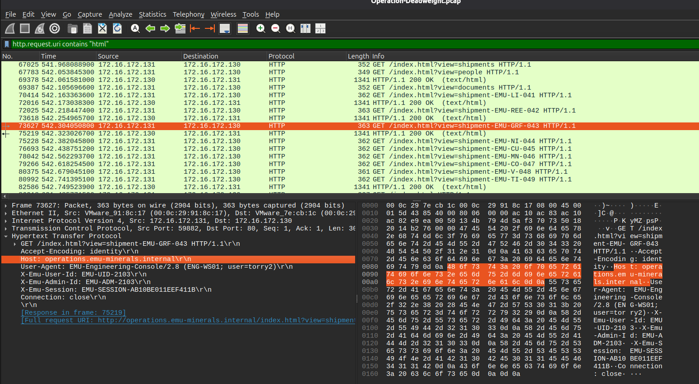

# Panc4ke's Missing Portal Solution

Difficulty: Very Easy

## Question

EMU Industries’ Procurement Officer, Panc4kes, is asking for the Operations portal domain again?!

**Submit:** EMU{domain}.

## **Overview**

This challenge asks you to identify the domain hosting the Operations intranet site. Pretty straightforward.

This sets the scene and provides a better understanding of the OT environment and corporate intranet. The site provides access to equipment records, corporate documents and staff information. It also captures live telemetry which is relevant for later challenges.

## Solution

The domain can be identified using Wireshark's [HTTP Statistics](https://www.wireshark.org/docs/wsug_html_chunked/ChStatHTTP.html) or by filtering for requests containing `index.html` using `http.request.uri`:

```
display filter: http.request.uri contains "html"
```



Looking at the packet details, the Host field should show `operations.emu-minerals.internal`.

## Answer

EMU{operations.emu-minerals.internal}
