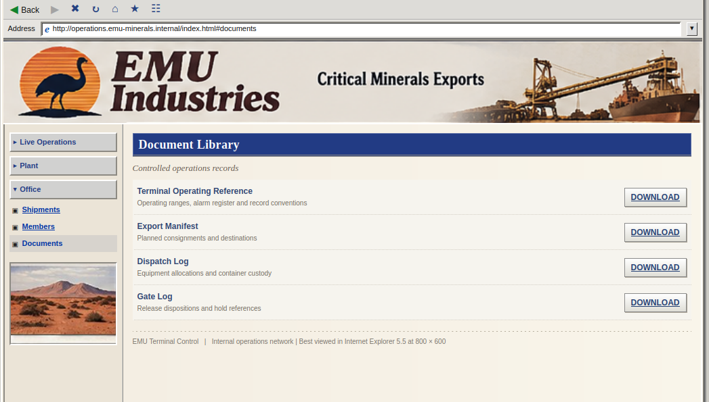
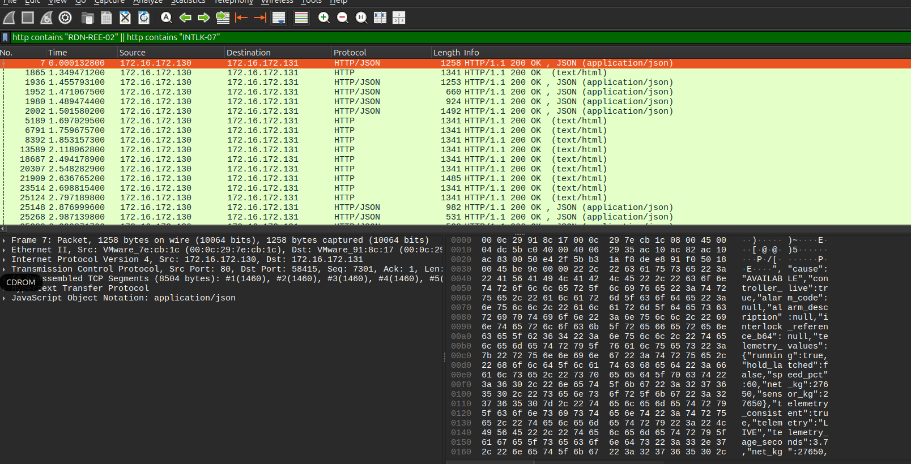

# Weight Off Its Shoulders Solution

**Difficulty:** Medium

## Question

Something’s not adding up at EMU Industries’ Red Dune site! An overweight alert has brought their shipment to a halt. Can you track down the interlock reference ID?

**Submit:** EMU{decoded_value}.

## **Overview**

This challenge asks you to find the interlock reference ID behind the shipment delay at EMU Industries’ Red Dune Rare Earths site.

The `torry2` account was used to change the site's weight limit from 30,000 kg to 20,000 kg, triggering an overweight interlock because the load was 24,800 kg. Although the original limit was restored, the equipment remained locked, leaving the shipment stuck.

The challenge asks you to find and decode the Base64-encoded interlock reference ID associated with the alarm.

The reference can be found in the live-status telemetry and json files captured in the PCAP  file.

## Solution

Ideally, you should have already exported the HTTP objects from the PCAP in Challenge 2. If you haven't, Export the files by clicking Save All. You can follow the [Wireshark documentation](https://www.wireshark.org/docs/wsug_html_chunked/ChIOExportSection.html) if needed.

To start the investigation, you can get some useful context from the documents located on the [Documents page](http://operations.emu-minerals.internal/index.html#documents).



The `terminal-operating-reference.txt` file is particularly useful, as it contains important information about the site's alarm and alert codes.

You can find it here: `file:///home/serveradmin/Documents/Export/documents/terminal-operating-reference.txt`.


The error code we're specifically looking for is `INTLK-07`, which is the overweight interlock code used for a safety stop.

There are two reasons why this is important. First, the question mentions that "an overweight alert has brought their shipment to a halt." Second, the alarm register gives us the exact code we need to start filtering through the packets in Wireshark.

```
INTLK-07 | OVERWEIGHT | Measured net load exceeds the active weighbridge limit.
```

By now, you should have access to the network topology from Challenge 2. The question asks you to find the error code for the Red Dune site. Looking at the network topology, you can see that Red Dune Rare Earths Loadout is referenced as `RDN-REE-02 / BAY02`.

We'll need both the site code and the error code to narrow down the search.


So, we now have three parameters we can filter on.

| Field or code | Meaning |
| --- | --- |
| `RDN-REE-02` | Red Dune's equipment ID. |
| `OVERWEIGHT` | The load exceeds the configured weight limit. |
| `INTLK-07` | The code for the overweight interlock, a safety stop. |

We can filter for any packets containing the Red Dune site ID `RDN-REE-02` or the error code `INTLK-07`.

```
display filter: http contains "RDN-REE-02" || http contains "INTLK-07"
```



Maybe by following the TCP or HTTP stream will give us more information on why these codes are showing up.


There's a lot of information, but luckily, searching for the `OVERWEIGHT` parameter we found in the document narrows it down a bit. Next to the `OVERWEIGHT` parameter, we can see the `interlock_reference_b64` field:

```
"interlock_reference_b64":"UkROX1JFRV8wMl9PVkVSV0VJR0hUX0lOVExLXzA3XzREN0E5MkMx"
```

The encoded value is:

```
UkROX1JFRV8wMl9PVkVSV0VJR0hUX0lOVExLXzA3XzREN0E5MkMx
```

Decoding it from Base64 gives us:

`RDN_REE_02_OVERWEIGHT_INTLK_07_4D7A92C1`

## Answer

EMU{RDN_REE_02_OVERWEIGHT_INTLK_07_4D7A92C1}

## Other Info

The `torry2` account looks like it was being used to test the waters, seeing what access it had and what changes it could make within the OT environment. The account was used to change the weight limits at three sites: Red Dune Rare Earths (Unit 2 / `RDN-REE-02`) from 30,000 kg to 20,000 kg; Saltbush Graphite (Unit 3 / `SLT-GRF-03`) from 30,000 kg to 16,000 kg; and Nullarbor Titanium (Unit 9 / `NLB-TI-09`) from 36,000 kg to 24,000 kg.
