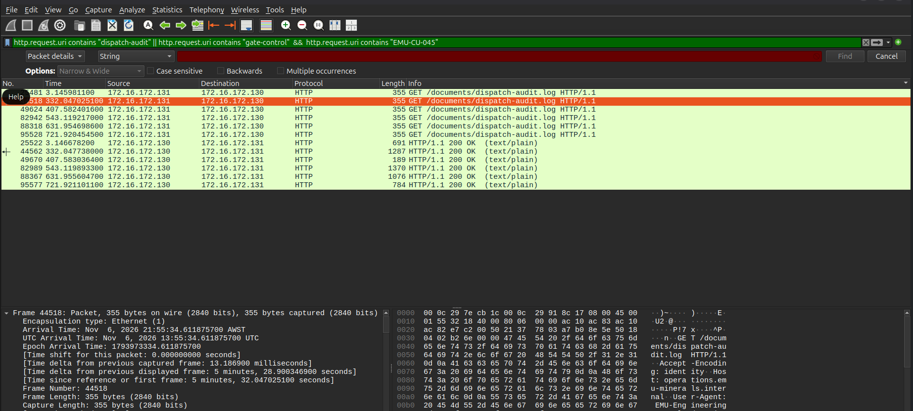
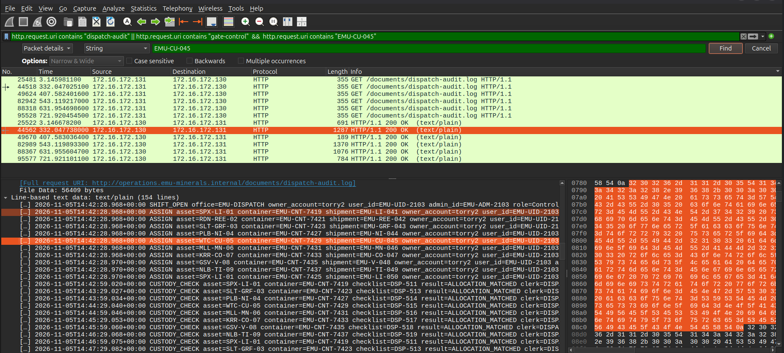
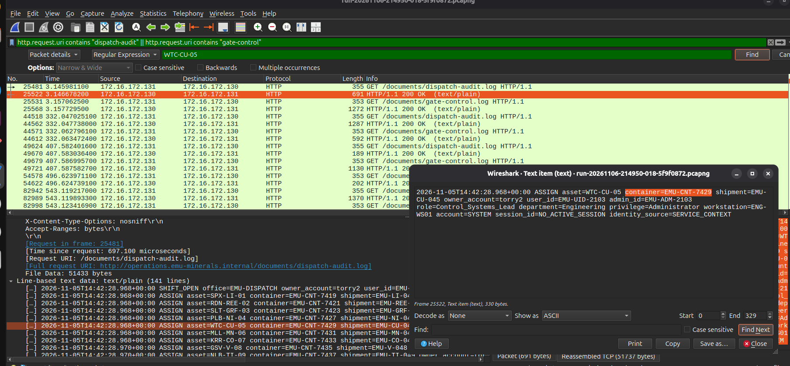
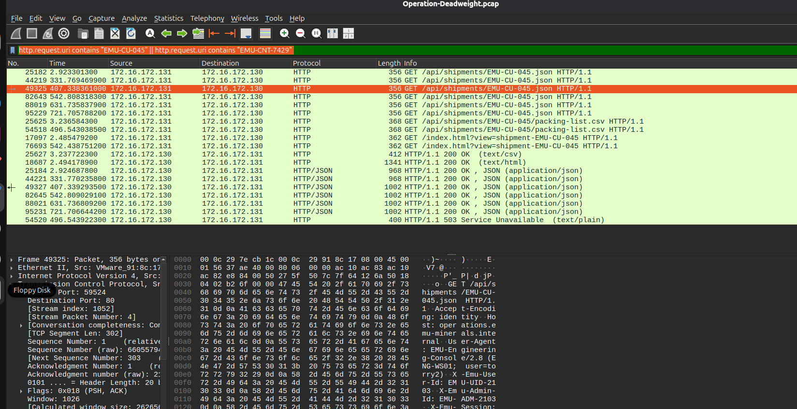
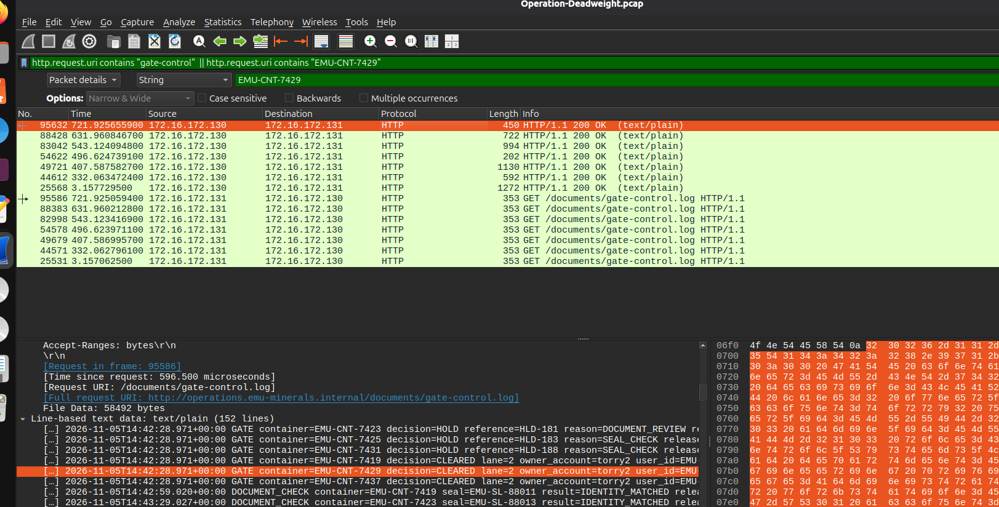
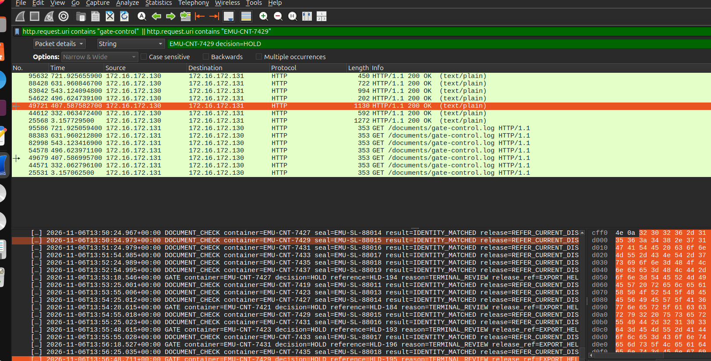
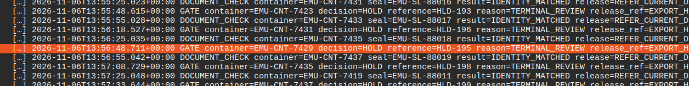
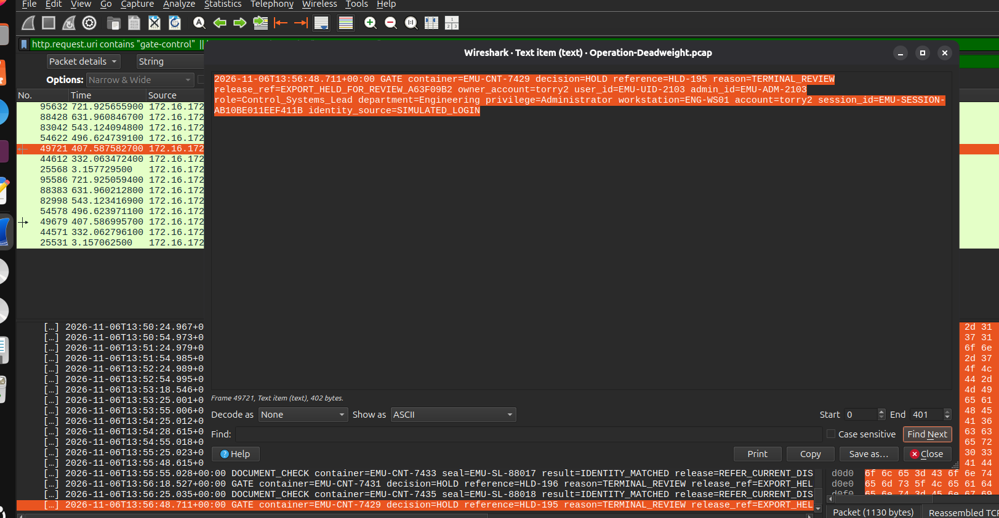

# What's the "HOLD" up

What's the "HOLD" up **solution**

**Difficulty:** Hard

## Question

Our General Manager toasterpwn is sweating! That busted Wattle Creek Copper drive left a loaded container stranded on the dock. The `dispatch-audit looks` okay, but now it's stuck at the `gate-control` going nowhere. Dig through the paper trail and find the release reference ID before EMU industries stock price tank.

**Submit:** EMU{release_reference}.

## **Overview**

This challenge picks up where the i'm speed challenge left off. You should have already discovered in Challenge 4 that the `torry2` account drove Wattle Creek Copper (`WTC-CU-05`) to 300% speed, triggering the `DMG-04` drive damage fault. That fault cascades into the terminal's shipping workflow, freezing the export shipment tied to the site.

For this challenge, you need to trace the cascade across two separate logs, specifically the Dispatch and Gate logs, to recover the exact release reference for the withheld shipping container.

The catch? The shipping records are deliberately designed so that no single record directly links the damaged asset to its release reference. You'll need to correlate information across both logs, which makes this particularly challenging given all the noise in the records and other halted containers. especially if you haven't completed the previous four challenges.

## Solution

You should already have the following information from Challenge 4. so now we currently have;

| Field or code | Meaning |
| --- | --- |
| `WTC-CU-05` | Wattle Creek Copper's equipment ID. |
| `BAY05` | The loadout bay associated with the equipment. |
| `UNIT=5` | The controller unit number for Wattle Creek Copper. |
| `EMU-CU-045` | The shipment ID linked to Wattle Creek Copper Loadout. |

The challenge asks us to follow the paper trail through the Dispatch and Gate logs to track down the release reference ID, so it's worth looking through these logs using the information we've already found. There are references to the logs on the EMU documentation page, where you can export them and analyse them.

We can filter the HTTP requests for `dispatch-audit` and `gate-control` to narrow down the search to the two shipping logs, then look for Wattle Creek's equipment ID, `WTC-CU-05`. 

```
display filter: http.request.uri contains "dispatch-audit" || http.request.uri contains "gate-control"  &&  http.request.uri contains "EMU-CU-045" 
```



Search for the string `EMU-CU-045`, and we should find a matching entry.



```
2026-11-05T14:42:28.968+00:00
EVENT=ASSIGN
ASSET=WTC-CU-05
CONTAINER=EMU-CNT-7429
SHIPMENT=EMU-CU-045
OWNER_ACCOUNT=torry2
USER_ID=EMU-UID-2103
ADMIN_ID=EMU-ADM-2103
ROLE=Control_Systems_Lead
DEPARTMENT=Engineering
PRIVILEGE=Administrator
```

The Dispatch Log confirms that shipment `EMU-CU-045` is linked to Wattle Creek's equipment ID, `WTC-CU-05`. More importantly, we've found a new piece of information: `CONTAINER=EMU-CNT-7429`.

Since the challenge mentions a stranded shipment, we can now use this container number to track down its status in the Gate logs.

| Field or code | Meaning |
| --- | --- |
| `EMU-CNT-7429` | The container number linking the shipment to the Dispatch and Gate logs. |

Let's check if there's anything linking Wattle Creek's equipment ID, `WTC-CU-05`, to container `EMU-CNT-7429`.

```
display filter: http.request.uri contains "EMU-CU-045" || http.request.uri contains "EMU-CNT-7429"
```

Select a `dispatch-audit` request, right-click the packet and choose Follow, then TCP Stream.

Search for `WTC-CU-05`. 



You should be able to find the associated container number, `EMU-CNT-7429`, which links Unit 5's equipment ID to its shipment in the Dispatch Log.

```
asset=WTC-CU-05 container=EMU-CNT-7429
```

We should start by filtering for `EMU-CNT-7429` and `EMU-CU-045` to see what comes up.

```
display filter: http.request.uri contains "EMU-CU-045" || http.request.uri contains "EMU-CNT-7429"
```



```
25182  2.923301300  172.16.172.131  172.16.172.130  HTTP       356  GET /api/shipments/EMU-CU-045.json HTTP/1.1
25625  3.236584300  172.16.172.131  172.16.172.130  HTTP       368  GET /api/shipments/EMU-CU-045/packing-list.csv HTTP/1.1
25184  2.924687800  172.16.172.130  172.16.172.131  HTTP/JSON  968  HTTP/1.1 200 OK, JSON (application/json)
```

These results contain shipment JSON records and API calls relating to the shipment's status. However, based on the challenge description, we're specifically looking for Gate Control logs to determine why the container was held.

Let's search for `gate-control` and the associated container number.

```
display filter: http.request.uri contains "gate-control" || http.request.uri contains "EMU-CNT-7429"
```

Then search for `EMU-CNT-7429` within the relevant logs.



You'll notice two types of gate decisions in the logs:

```
decision=HOLD
decision=CLEARED
```

These indicate whether a container has been placed on hold or cleared for departure.

We need to find the exact container number, `EMU-CNT-7429`, and identify its `HOLD` entry.

```
container=EMU-CNT-7429 decision=HOLD
```





We found an entry confirming that `EMU-CNT-7429` was placed on hold, while the other records show containers being cleared.



```
2026-11-06T13:56:48.711+00:00
GATE
container=EMU-CNT-7429
decision=HOLD
reference=HLD-195
reason=TERMINAL_REVIEW
release_ref=EXPORT_HELD_FOR_REVIEW_A63F09B2
owner_account=torry2
user_id=EMU-UID-2103
admin_id=EMU-ADM-2103
role=Control_Systems_Lead
department=Engineering
privilege=Administrator
workstation=ENG-WS01
account=torry2
session_id=EMU-SESSION-AB10BE011EEF411B
identity_source=SIMULATED_LOGIN
```

We are looking for the `release_ref`, which is `EXPORT_HELD_FOR_REVIEW_A63F09B2`.

## Answer

`EMU{EXPORT_HELD_FOR_REVIEW_A63F09B2}`

## Other Info

The `torry2` account was also involved in disrupting other containers. Each hold has a release reference in the same format, but only one belongs to Unit 5's container, `EMU-CNT-7429`. The logs contain ten unique hold references, as shown below.

| Container | Hold ID | Release reference |
| --- | --- | --- |
| `EMU-CNT-7423` | `HLD-181` | `EXPORT_HELD_FOR_REVIEW_47B4E7AB` |
| `EMU-CNT-7425` | `HLD-183` | `EXPORT_HELD_FOR_REVIEW_FD1E7897` |
| `EMU-CNT-7431` | `HLD-188` | `EXPORT_HELD_FOR_REVIEW_EDB09AA1` |
| `EMU-CNT-7421` | `HLD-184` | `EXPORT_HELD_FOR_REVIEW_08CE2775` |
| `EMU-CNT-7423` | `HLD-193` | `EXPORT_HELD_FOR_REVIEW_3285D500` |
| `EMU-CNT-7427` | `HLD-194` | `EXPORT_HELD_FOR_REVIEW_B2BD2522` |
| **`EMU-CNT-7429`** | **`HLD-195`** | **`EXPORT_HELD_FOR_REVIEW_A63F09B2`** |
| `EMU-CNT-7431` | `HLD-196` | `EXPORT_HELD_FOR_REVIEW_0082F87F` |
| `EMU-CNT-7435` | `HLD-198` | `EXPORT_HELD_FOR_REVIEW_2D6CFBFF` |
| `EMU-CNT-7437` | `HLD-199` | `XPORT_HELD_FOR_REVIEW_B0AD07BA` |
