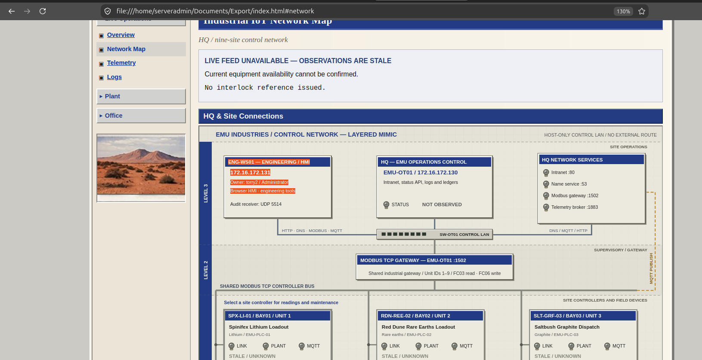
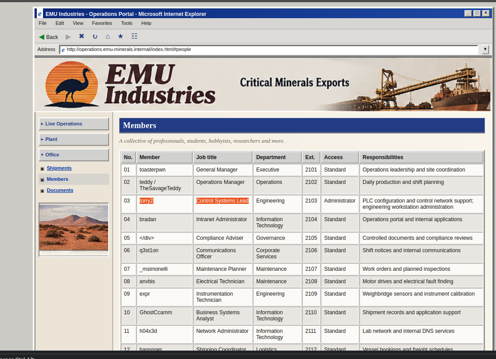

# Whose Workstation Is It Anyway? Solution

**Difficulty:** Easy

## Question

Looks like EMU Industries is in a spot of trouble. Who owns the Engineering workstation?

**Submit:** EMU{role_here}.

## **Overview**

This challenge asks you to identify who owns engineering workstation `ENG-WS01` and what their role is. The workstation belongs to `torry2`, who is the `Control_Systems_Lead`. Don’t ask him, he probably doesn’t know.

`torry2`'s session ID and role can be found in the controller audit messages (UDP port 5514), logs, and network topology displayed on the website.

## Solution

You can see the whole network topology and devices of EMU Industries’ on their operational portal sites. To view it:

- In Wireshark, go to **File → Export Objects → HTTP** ([Wireshark documentation](https://www.wireshark.org/docs/wsug_html_chunked/ChIOExportSection.html))
- Save All and open the `index.html` file.

Navigate to [http://operations.emu-minerals.internal/index.html#network](http://operations.emu-minerals.internal/index.html#network) to see the network topology, including the workstations and who owns them.

You can also browse the Office Panel and navigate to the Members page (index.html#people) to find `torry2` role.

## Answer

EMU{Control Systems Lead}

`Control Systems Lead` Also accept: `Control_Systems_Lead`.

## Other Info

For the sake of the scenario, he has elevated privileges, which allow him to perform certain configuration changes at the OT sites. This will be relevant in later challenges.

The Logs deliberately doesn't reveal the initial access method, so whether `torry2` is an insider threat is still up for debate.
