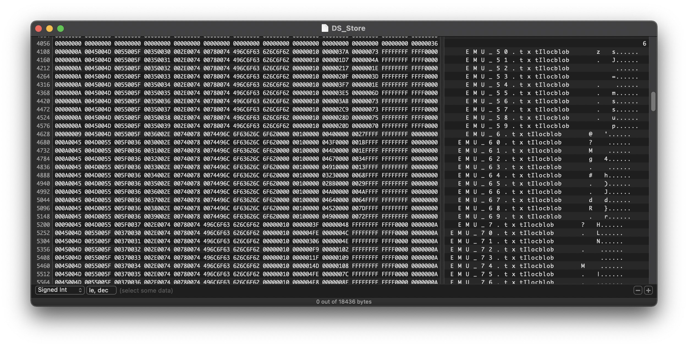
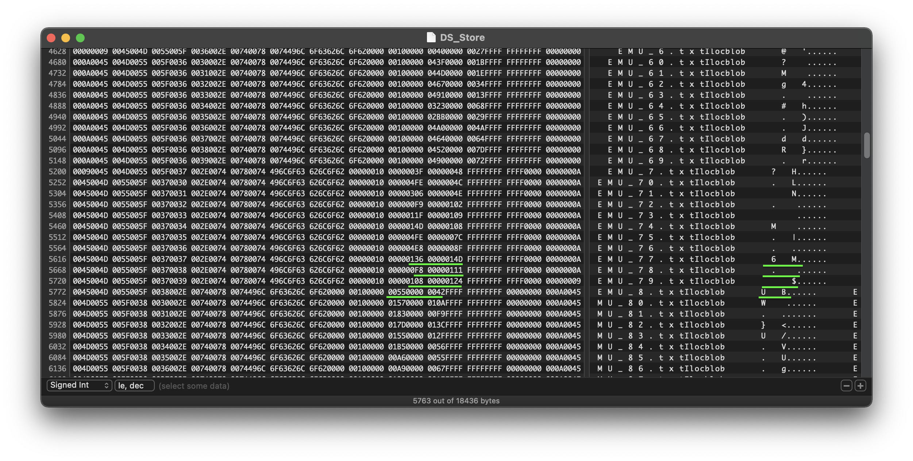
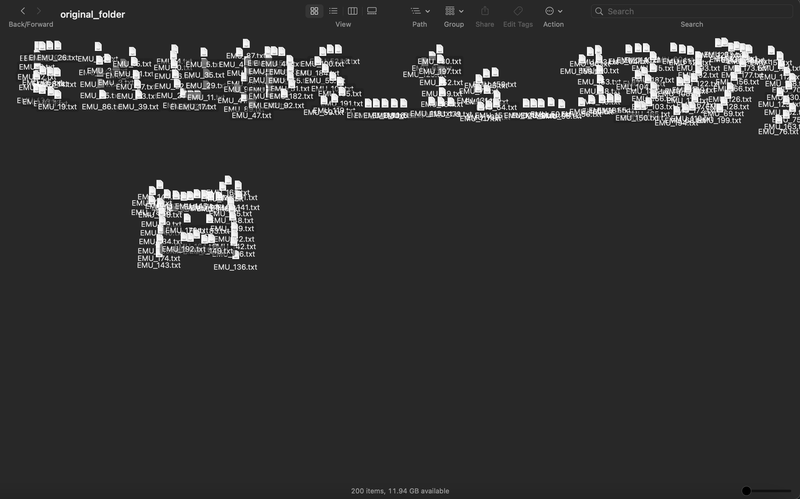

We are presented with a `DS_Store` file. Searching up the file, we see `.DS_Store` is a MacOS exclusive file, that essentially tells Finder (Mac equivilent of Windows File Explorer) where files are visually in the folder, and other information about visuals of files and folders.

From Wikipedia:
> DS_Store is a file that stores custom attributes of its containing folder, such as folder view options, icon positions, and other visual information. The name is an abbreviation of Desktop Services Store, reflecting its purpose.

Note that the only information about files and folders saved are their visual attributes, we cannot see the contents of the files.

Opening up the provided `DS_Store` file in a hex editor, we see many filenames such as `EMU_167.txt` - there are around 200 files.



Researching a bit about DS_Store files brings us to [this resource](https://metacpan.org/dist/Mac-Finder-DSStore/view/DSStoreFormat.pod) about the DS_Store file format, which has this info:

> `'Iloc'`
> 16-byte blob, attached to files and directories. The file's icon location. Two 4-byte values representing the horizontal and vertical positions of the icon's center (not top-left). (Then, 6 bytes 0xff and 2 bytes 0?) For the purposes of the center, the icon only is taken into account, not any label. The icon's size comes from the icvo blob.

Notice that in our hexdump there is a string of text `Ilocblob` after each filename. The resource states there are 

> Two 4-byte values representing the horizontal and vertical positions of the icon's center (not top-left).

We can verify this by looking at the hexdump:



Notice the values underlined seem to be some sort of coordinates, which actually represents the icon location within the folder!

We can write a short python script to extract those 4-byte x and y coordinates and plot them.

```py
import matplotlib.pyplot as plt

with open("./DS_Store", "rb") as f:
    data = f.read()

data = data.split(b"tIlocblob")
x = []
y = []
for txt_file in data:
    # Get coordinate value from hex at each filename offset
    x.append(int.from_bytes(txt_file[4:8], byteorder='big'))
    y.append(int.from_bytes(txt_file[8:12], byteorder='big'))

# Remove first point (outlier/not proper coordinate)
x.pop(0)
y.pop(0)

'''
Flip y around (as y represents value from the top, 
not bottom, so it will be flipped otherwise)
'''
max_y = max(y)
y = [max_y - i for i in y] 

fig, ax = plt.subplots()
ax.scatter(x, y, s=100)
plt.show()
```

Running this plots points which form the flag! There's also a cute bear ʕ •ᴥ•ʔ


We get the flag: `EMU{DS_1s_1337}`

Here's what the folder originally looked like if you're curious:




## Extra

btw, i wrote this challenge (and writeup) all the way back in 2023, but we never ran EMUCTF :skull:
pretty nostalgic
