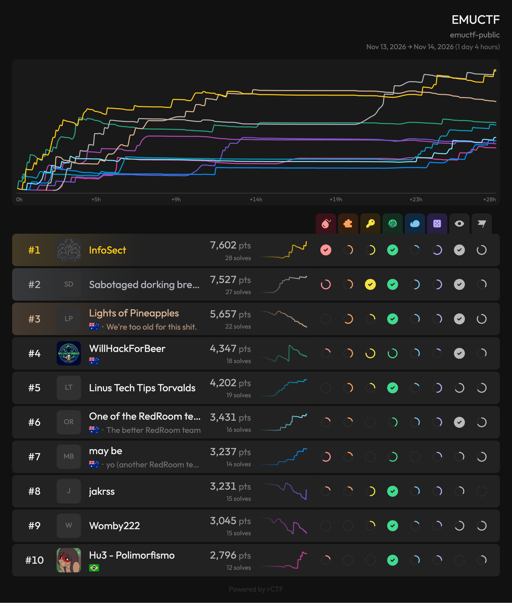

# emuctf-public

Challenge source and writeups from EMUCTF.

2026

[2026 challenge source](./2026/)

Rules

# Welcome
Welcome to EMUCTF at BSides Perth 2026! 

This is the competition platform and the source of truth for rules. We hope you enjoy!
- Discord Support: https://discord.gg/Dx6FfzwKyQ

CTF Open - 10AM Friday till 2PM Saturday

# FEEDBACK RELEASED
`misc/feedback` released - this is worth 1 point and we'd appreciate your thoughts :)

# HINTS RELEASED (Updated 10AM Saturday)

`pwn/checkmate`
> Use the bug to capture stockfish's king!

`reverse/hermes-gets-angy`
> You are given enough debug symbols. Also the VM runtime for the latest version is open source.
NOTE: Solving this challenge and `reverse/hermes-gets-twitchy` has a $50 cash bounty - submit  a ticket with a writeup for both by the end of the CTF

`web/gimme-ya-claude`
> whats your controllable input, whats your controllable input that isn't obvious

`web/xss-bot`
> there are a bunch of articles about when this goof is done

`web/duck-duck-go`
> I have published stuff about the different parts you need todo. It might help to work backwards.
^ghostccamm
> Screw it, another hint for duckduckgo. Beego web framework should burn to the ground.

`misc/emucon`
> `echo emucon | sed -E 's/(...)(...)/\2\1/'`

# Rules 

- Register one account per team.
- Maximum of 5 players per team.
- The flag format is `EMU{.*}`
- Collaboration/Collusion between teams is forbidden.
- Targeting infrastructure, or other services not part of the challenge is forbidden.
- Your entire team must be present at BSides Perth to be eligible for prizes.
- Failure to comply with any rules could result in removal of solves, public shaming, and/or bans from the CTF.
- All decisions made by the Emu Exploit team are final.
- Be nice and have fun!

# AI/LLM Rules
Our AI rules are inspired by the BSides Canberra CTF. You can find their rules [here](https://2026.sk8.dog/rules).
- AI/LLM Usage is strictly forbidden.
 - This includes chat bots, agentic tooling, editor assistants, or anything else which uses AI models as part of your workflow.
- You must not attempt to prompt, or upload any significant portion of challenge contents into any search engine with AI enabled.
- You must NOT expand or interact with any AI search results (Such as google AI overview), including clicking "Show More" or copy/pasting content to/from it.

- If you are unsure about whether something is allowed or not, contact us first.
- `EMU{I_PROMISE_I_WONT_USE_AI}`

# Prizes
The top 3 teams will receive the following prizes:
- 1st - Bambu Labs Combo 3d Printer
- 2nd - Raspberry Pi 5 Starter Kit 8GB
- 3rd - Pi400

# Physsec Prizes
The top 2 teams in the "phys" category will receive the following prizes:
- 1st - Sparrows EOD Lock Pit Set + Ripcord
- 2nd - Practice Handcuffs + x3 Credit card lock pick set

Scoreboard

- [Closing Ceremony](https://youtu.be/2FwZyfxI_n4?t=24734)

### Pwn

| Challenge | Author | Difficulty | Solves | Writeup |
| --- | --- | --- | --- | --- |
| [babykernel](./2026/pwn/babykernel/) | toasterpwn | hard | 2 | [Writeup](./2026/pwn/babykernel/solve/README.md) |
| [checkmate](./2026/pwn/checkmate/) | toasterpwn | Hard | 2 | [Writeup](./2026/pwn/checkmate/solve/README.md) |
| [ftp1](./2026/pwn/ftp1/) | toasterpwn | Easy | 8 | [Writeup](./2026/pwn/ftp1/solve/README.md) |
| [ftp2](./2026/pwn/ftp2/) | toasterpwn | Medium | 2 | [Writeup](./2026/pwn/ftp2/solve/README.md) |
| [pie](./2026/pwn/pie/) | toasterpwn | Easy | 5 | [Script](./2026/pwn/pie/solve/x.py) |

### Reverse Engineering

| Challenge | Author | Difficulty | Solves | Writeup |
| --- | --- | --- | --- | --- |
| [easycrab](./2026/rev/easycrab/) | toasterpwn | Easy | 9 | [Writeup](./2026/rev/easycrab/solve/README.md) |
| [emu-run](./2026/rev/emu-run/) | Panc4kes | Easy | 2 | [Writeup](./2026/rev/emu-run/solve/SOLVE.md) |
| [hermes-gets-angy](./2026/rev/hermes-gets-angy/) | nullableVoidPtr | Hard | 0 | [Writeup](./2026/rev/hermes-gets-angy/solve/SOLVE.md) |
| [hermes-gets-twitchy](./2026/rev/hermes-gets-twitchy/) | nullableVoidPtr | Medium | 1 | [Writeup](./2026/rev/hermes-gets-twitchy/solve/SOLVE.md) |
| [reversing](./2026/rev/reversing/) | toasterpwn | Beginner | 14 | [Writeup](./2026/rev/reversing/solve/README.md) |

### Physical

| Challenge | Author | Difficulty | Solves | Writeup |
| --- | --- | --- | --- | --- |
| [decode1](./2026/phys/decode1/) | evildaemond | Easy | 2 | No writeup |
| [decode2](./2026/phys/decode2/) | evildaemond | Medium | 2 | No writeup |
| [door1](./2026/phys/door1/) | evildaemond | Medium | 15 | No writeup |
| [door2](./2026/phys/door2/) | evildaemond | Hard | 10 | No writeup |
| [door3](./2026/phys/door3/) | evildaemond | Insane | 7 | No writeup |
| [rex](./2026/phys/rex/) | evildaemond | Medium | 15 | No writeup |

### Web

| Challenge | Author | Difficulty | Solves | Writeup |
| --- | --- | --- | --- | --- |
| [duck-duck-go](./2026/web/duck-duck-go/) | mc fat monke | Insane | 0 | [Writeup](./2026/web/duck-duck-go/solve/solve.md) |
| [gimme-ya-claude](./2026/web/gimme-ya-claude/) | mc fat monke | Insane | 0 | [Script](./2026/web/gimme-ya-claude/solve/exploit.sh) |
| [insecurely-integrated](./2026/web/insecurely-integrated/) | mc fat monke | Easy | 8 | [Writeup](./2026/web/insecurely-integrated/solve/SOLVE.md) |
| [integrated](./2026/web/integrated/) | mc fat monke | Medium | 1 | [Writeup](./2026/web/integrated/solve/SOLVE.md) |
| [ping](./2026/web/ping/) | toasterpwn | Beginner | 23 | [Script](./2026/web/ping/solve/solve.py) |
| [xss-bot](./2026/web/xss-bot/) | mc fat monke | Insane | 0 | [Writeup](./2026/web/xss-bot/solve/README.md) |

### Crypto

| Challenge | Author | Difficulty | Solves | Writeup |
| --- | --- | --- | --- | --- |
| [delphi](./2026/crypto/delphi/) | toasterpwn | Beginner | 11 | [Writeup](./2026/crypto/delphi/solve/README.md) |
| [instareal](./2026/crypto/instareal/) | Panc4kes | Medium | 2 | [Writeup](./2026/crypto/instareal/solve/SOLVE.md) |
| [morehashes](./2026/crypto/morehashes/) | toasterpwn | Easy | 6 | [Writeup](./2026/crypto/morehashes/solve/README.md) |
| [sms](./2026/crypto/sms/) | TheSavageTeddy | medium | 2 | [Script](./2026/crypto/sms/solve/solve.py) |

### Forensics

| Challenge | Author | Difficulty | Solves | Writeup |
| --- | --- | --- | --- | --- |
| [i-am-speed](./2026/forensics/i-am-speed/) | Div | Medium | 11 | [Writeup](./2026/forensics/i-am-speed/solve/README.md) |
| [portal-404](./2026/forensics/portal-404/) | Div | Beginner | 30 | [Writeup](./2026/forensics/portal-404/solve/README.md) |
| [weight-a-minute](./2026/forensics/weight-a-minute/) | Div | Medium | 16 | [Writeup](./2026/forensics/weight-a-minute/solve/README.md) |
| [whats-the-hold-up](./2026/forensics/whats-the-hold-up/) | Div | Hard | 12 | [Writeup](./2026/forensics/whats-the-hold-up/solve/README.md) |
| [whodunit](./2026/forensics/whodunit/) | Div | Easy | 26 | [Writeup](./2026/forensics/whodunit/solve/README.md) |

### Misc

| Challenge | Author | Difficulty | Solves | Writeup |
| --- | --- | --- | --- | --- |
| [corporate](./2026/misc/corporate/) | torry2 | Easy | 3 | [Writeup](./2026/misc/corporate/solve/SOLVE.md) |
| [corporate2](./2026/misc/corporate2/) | torry2 | Medium | 0 | [Writeup](./2026/misc/corporate2/solve/SOLVE.md) |
| [emucon](./2026/misc/emucon/) | Panc4kes | Medium | 0 | [Writeup](./2026/misc/emucon/solve/SOLVE.md) |
| [feedback](./2026/misc/feedback/) | Emu Exploit | N/A | 13 | N/A |
| [last-digit-v2](./2026/misc/last-digit-v2/) | TheSavageTeddy | Medium | 1 | [Writeup](./2026/misc/last-digit-v2/solve/README.md) |
| [mac-magic](./2026/misc/mac-magic/) | TheSavageTeddy | Easy | 10 | [Writeup](./2026/misc/mac-magic/solve/README.md) |
| [read-the-rules](./2026/misc/read-the-rules/) | toasterpwn | beginner | 44 | N/A |
| [tnt-autocannon](./2026/misc/tnt-autocannon/) | Panc4kes | Easy | 3 | [Writeup](./2026/misc/tnt-autocannon/solve/SOLVE.md) |

### OSINT

| Challenge | Author | Difficulty | Solves | Writeup |
| --- | --- | --- | --- | --- |
| [gambling](./2026/osint/gambling/) | toasterpwn | Beginner | 8 | [Writeup](./2026/osint/gambling/solve/README.md) |
| [landmark](./2026/osint/landmark/) | mc fat monke | Easy | 27 | [Writeup](./2026/osint/landmark/solve/SOLVE.md) |
| [touch-grass](./2026/osint/touch-grass/) | toasterpwn | Hard | 13 | [Writeup](./2026/osint/touch-grass/solve/README.md) |

